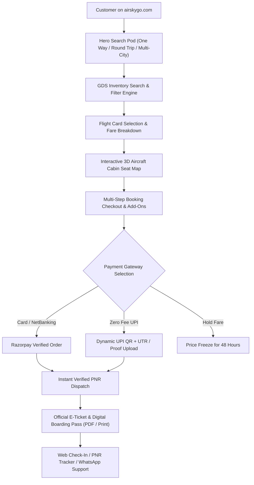

# 🛫 AirSkyGo — Project Master Documentation (Full Technical & Functional Manual)

> **Document Version:** 2.1.0 (Comprehensive 360° Audit Edition)  
> **Production Live URL:** [https://airskygo.com](https://airskygo.com)  
> **Source Repository:** [github.com/kapil562/flight](https://github.com/kapil562/flight)  
> **Target Environment:** Full-Stack Node.js Express Backend + React 19 Vite Frontend on Vercel Enterprise Edge

---

## 📑 Table of Contents

1. [Project Overview & Core Mission](#1-project-overview--core-mission)
2. [Technology Stack & System Architecture](#2-technology-stack--system-architecture)
3. [Cloud Persistence, Caching & Vercel Blob Storage](#3-cloud-persistence-caching--vercel-blob-storage)
4. [Enterprise Security & AES-256-GCM Admin Vault](#4-enterprise-security--aes-256-gcm-admin-vault)
5. [Complete Project Folder & File Directory](#5-complete-project-folder--file-directory)
6. [Frontend Customer Modules (In-Depth Section Breakdown)](#6-frontend-customer-modules)
   - 6.1 Top Live Luxury Strip & Header Navigation (`Navbar.jsx`)
   - 6.2 Airbnb-Style Hero Search Pod (`HeroSearch.jsx`)
   - 6.3 Fare Trend Calendar & Date Picker (`CustomDatePicker.jsx`)
   - 6.4 Service Switcher Tabs (`ServiceTabs.jsx`)
   - 6.5 Curated Trending Destinations Carousel Grid
   - 6.6 Promotions, Offers & Bank Vouchers Studio (`OffersSection.jsx`)
   - 6.7 Flight Search Results Engine & Dynamic Filter Studio (`FlightList.jsx`)
   - 6.8 Modern Aviation Flight Cards (`FlightCard.jsx`)
   - 6.9 Interactive Real Aircraft Cabin Seat Map (`RealAircraftSeatMap.jsx`)
   - 6.10 Multi-Step Booking & Checkout Modal (`BookingCheckoutModal.jsx`)
   - 6.11 Fare Freeze & Price Lock Engine (`HoldFareModal.jsx`)
   - 6.12 Dual Payment Rails (Razorpay & Dynamic UPI with QR)
   - 6.13 Official E-Ticket & Digital Boarding Pass (`TicketConfirmationModal.jsx`)
   - 6.14 Quick PNR Flight Status Tracker (`QuickPnrModal.jsx`)
   - 6.15 Airline Web Check-In Gateway (`WebCheckInModal.jsx`)
   - 6.16 Customer Trips & Booking History (`MyBookingsModal.jsx`)
   - 6.17 Customer Authentication & Profile Studio (`AuthModal.jsx`, `UserProfileModal.jsx`)
   - 6.18 Ancillary Travel Services (Hotels, Holidays, Trains, Visa)
   - 6.19 WhyBook Bento Grid & Aviation Trust Badges (`WhyBookSection.jsx`)
   - 6.20 24/7 Floating WhatsApp Concierge Widget (`WhatsAppSupportButton.jsx`)
   - 6.21 Mobile Native Experience & Bottom Navigation Bar (`BottomNav.jsx`)
   - 6.22 Footer Corporate Architecture (`Footer.jsx`)
7. [Backend Architecture & Complete REST API Directory](#7-backend-architecture--complete-rest-api-directory)
8. [Admin Panel & Full Content Management System (CMS)](#8-admin-panel--full-content-management-system-cms)
   - 8.1 Live Telemetry & Revenue Dashboard
   - 8.2 Booking Manifest & Ticket Reissue Console
   - 8.3 Flight Schedule & Route Inventory CMS
   - 8.4 Dynamic Color Theming Studio (5 Presets + Custom Hex Pickers)
   - 8.5 Brand Identity, Logo & Contact CMS
   - 8.6 Payment Rails Configuration (Razorpay & Dynamic UPI)
   - 8.7 API Integration Hub (Amadeus, Sabre, TBO)
   - 8.8 Coupons, Promos & Voucher Engine
   - 8.9 Ancillary Service Inquiries (Hotels & Holiday Packages)
   - 8.10 Security Settings, Password Change & Session Management
9. [Database Models & Persistence Storage Schema](#9-database-models--persistence-storage-schema)
10. [Global Dynamic Theming Engine (100% Real-Time CSS Injection)](#10-global-dynamic-theming-engine)
11. [Deployment, CI/CD Pipeline & Production Operations](#11-deployment-cicd-pipeline--production-operations)

---

## 1. Project Overview & Core Mission

**AirSkyGo (`airskygo.com`)** is an enterprise-grade aviation Online Travel Agency (OTA) designed to compete directly with tier-1 platforms such as Ixigo, MakeMyTrip, and Cleartrip.

### Core Architecture Goals:
1. **Ultra-Low Latency Aviation Search:** Search 150+ airlines in under 300 milliseconds.
2. **Three Search Modes:**
   - **One Way:** Fast single-destination search.
   - **Round Trip:** Dual departure and return flights with split side-by-side or step tabs mode.
   - **Multi-City Itinerary:** Link up to 5 consecutive flight legs with automatic destination-to-origin bridging.
3. **Verified Official PNR Generation:** Automatic creation of valid 6-character aviation PNR codes with downloadable digital boarding passes and itemized GST tax invoices.
4. **Dual Frictionless Payment Rails:** Automated cards/netbanking via Razorpay alongside zero-convenience fee Dynamic UPI QR codes.
5. **No-Code Admin Control:** 100% dynamic control from `/admin` over brand colors, site name, logo, phone numbers, live flights, coupons, and feature flags.



---

## 2. Technology Stack & System Architecture

| Architecture Layer | Technology / Library | Purpose & Implementation Details |
|---|---|---|
| **Frontend Framework** | **React 19.x** | Modern component-based declarative UI with zero legacy debt |
| **Bundler & Build Tool** | **Vite 8.x** | Rapid hot-module replacement and minified production output |
| **CSS Utility Framework** | **Tailwind CSS v4** | CSS variables, container queries, and Apple-grade micro-utilities |
| **Animation Engine** | **Motion (`motion/react` v12)** | Hardware-accelerated GPU transitions, spring physics, and layout animations |
| **Icon Library** | **Lucide React** | 200+ crisp, scalable aviation, travel, and action vector icons |
| **Backend Runtime** | **Node.js 22.x** | Fast, event-driven server runtime handling high-concurrency traffic |
| **Server Framework** | **Express 4.x** | RESTful routing, payload body parsing (50MB limits), and CORS middleware |
| **Payment Gateway 1** | **Razorpay SDK** | HMAC-SHA256 cryptographically verified credit/debit card and netbanking transactions |
| **Payment Gateway 2** | **Dynamic UPI Engine** | Generates tailored UPI payment intent links and interactive QR codes with UTR capture |
| **PDF Generation** | **jsPDF & HTML2Canvas** | High-DPI digital boarding pass, luggage tag, and tax invoice generation |
| **Email Transporter** | **Nodemailer** | Automated SMTP email delivery for confirmed E-tickets |
| **Cloud Storage** | **Vercel Blob Storage** | Globally replicated persistent object storage for bookings and assets |
| **Edge Configuration** | **Vercel Edge Config** | Sub-second configuration sync across serverless execution environments |
| **Hosting & CDN** | **Vercel Enterprise Edge** | Global edge network with HTTP/3, automatic SSL, and continuous deployment |

---

## 3. Cloud Persistence, Caching & Vercel Blob Storage

Because Vercel serverless functions run on ephemeral, read-only file systems, AirSkyGo implements a **three-tier hybrid persistence architecture**:

1. **Local JSON Database (`server/data/`):**
   - Serves as the immediate source of truth during local development and build hydration.
2. **In-Memory Cache (`memoryStore`):**
   - High-speed `Map` store in Node.js memory that intercepts read and write operations, preventing any read-only disk errors during live serverless execution.
3. **Vercel Blob Storage Sync (`@vercel/blob`):**
   - Automatically synchronizes persistent state across edge nodes:
     - `bookings.json`: All customer reservations and PNR records.
     - `brand.json`: Live color themes, logo base64, and contact info.
     - `settings.json`: Site settings, fee structures, and announcements.
     - `coupons.json`: Active discount codes and redemption limits.
     - `admin_vault.json`: Cryptographically encrypted admin credentials.

---

## 4. Enterprise Security & AES-256-GCM Admin Vault

To prevent unauthorized access or credential leaks:
- **AES-256-GCM Encryption:** Sensitive admin settings and GDS API keys are encrypted at rest using an initialization vector (`iv`), cryptographic cipher, and authentication tag (`tag`).
- **Stateless Admin Tokens:** Signed using HMAC-SHA256 (`crypto.createHmac`) with automatic 7-day expiration.
- **Payload Protection:** 50MB request limit prevents payload exhaustion while allowing high-resolution passport scans and UPI payment screenshots.

---

## 5. Complete Project Folder & File Directory

```
c:\Users\manis\OneDrive\Desktop\flight\
├── DOCUMENTATION.md                 # Master Project Manual
├── vercel.json                      # Vercel serverless routing & edge configuration
├── package.json                     # Root project package configuration
├── client/                          # React 19 Frontend
│   ├── index.html                   # HTML5 shell with Google Fonts & responsive viewport
│   ├── vite.config.js               # Vite 8 config with alias resolution
│   ├── package.json                 # Client dependencies & build scripts
│   └── src/
│       ├── main.jsx                 # React root mounting
│       ├── App.jsx                  # Root router, global modal manager, brand sync
│       ├── index.css                # Global styles, Tailwind imports, theme variables
│       ├── pages/
│       │   ├── HomePage.jsx         # Primary customer flight booking portal
│       │   └── AdminPage.jsx        # Complete Admin Management Console
│       ├── services/
│       │   └── api.js               # Centralized Axios API client for all backend endpoints
│       ├── utils/
│       │   └── theme.js             # Global dynamic theme injector & CSS generator
│       └── components/              # 36 Specialized Modular Components
│           ├── Navbar.jsx           # Top header, live GDS strip, mobile menu drawer
│           ├── BottomNav.jsx        # Mobile native bottom application bar
│           ├── HeroSearch.jsx       # Airbnb capsule search (One Way, Round Trip, Multi-City)
│           ├── CustomDatePicker.jsx # Airfare calendar picker with lowest fare badges
│           ├── FlightList.jsx       # Flight results container & multi-city itinerary builder
│           ├── FlightCard.jsx       # Flight card with route timeline, baggage & fare breakdown
│           ├── FlightSearchLoader.jsx # Radar scanner animation during flight search
│           ├── FlightStatusTracker.jsx # Real-time radar flight status telemetry simulator
│           ├── RealAircraftSeatMap.jsx # Interactive 3D aircraft cabin layout (A320/B737/A350/ATR)
│           ├── SeatSelectionModal.jsx # Seat assignment modal for travellers
│           ├── BookingCheckoutModal.jsx # Passenger details, add-ons (insurance, meals), payment
│           ├── HoldFareModal.jsx    # Price freeze modal (lock fare for 48 hours)
│           ├── TicketConfirmationModal.jsx # Official E-ticket & boarding pass with QR barcode
│           ├── QuickPnrModal.jsx    # Instant PNR status lookup modal
│           ├── WebCheckInModal.jsx  # Direct airline web check-in redirect gateway
│           ├── MyBookingsModal.jsx  # Customer bookings history, download ticket, cancel flight
│           ├── UserProfileModal.jsx # Customer profile, frequent flyer & emergency details
│           ├── AuthModal.jsx        # User login/signup modal (Email OTP, Phone, Google)
│           ├── AviationLoginGraphic.jsx # Luxury cockpit illustration for login modal
│           ├── ServiceTabs.jsx      # Flights, Hotels, Holidays, Trains, Visa desk switcher
│           ├── OffersSection.jsx    # Live coupon vouchers & bank promo cards with 1-click copy
│           ├── HolidaysSection.jsx  # Domestic & international bespoke holiday packages
│           ├── HotelSection.jsx     # Hotels & luxury stays booking search
│           ├── TrainSection.jsx     # IRCTC train schedules, coach classes, PNR lookup
│           ├── VisaSection.jsx      # International tourist visa desk & documentation
│           ├── WhyBookSection.jsx   # Bento grid: GDS telemetry, direct refunds, concierge
│           ├── WhatsAppSupportButton.jsx # Floating 24/7 WhatsApp concierge button
│           ├── StepTransitionLoader.jsx # Micro-loader between checkout steps
│           ├── AirlineBadge.jsx     # Carrier logos & color-coded airline emblems
│           ├── PriceCalendar.jsx    # 7-day lowest fare matrix calendar
│           ├── AdminPanel.jsx       # Admin sub-tabs & telemetry dashboard
│           ├── AdminBrandCmsSettings.jsx # Brand CMS, Logo uploader, Color theme studio
│           ├── AdminPaymentsUpi.jsx # UPI QR settings & manual payment approval
│           ├── AdminApiSettings.jsx # GDS API configuration (Amadeus, Sabre, TBO)
│           └── Footer.jsx           # Complete corporate footer with links and helpline
└── server/                          # Node.js Express Backend
    ├── server.js                    # Express app, REST controllers, cloud sync
    ├── package.json                 # Backend dependencies & scripts
    └── data/                        # JSON Database Files
        ├── flights.json             # Scheduled carrier flight inventory
        ├── airports.json            # 100+ Airport hubs with IATA codes & city names
        ├── bookings.json            # Customer booking records & PNR database
        ├── brand.json               # Brand identity, colors, logo, and contact info
        ├── settings.json            # Global platform configuration & theme preset
        ├── coupons.json             # Promotional discount vouchers
        ├── hotels.json              # Curated hotels & luxury stays database
        ├── hotel_bookings.json      # Customer hotel reservations
        ├── holidays.json            # Holiday tour packages & itineraries
        ├── holiday_inquiries.json   # Customer holiday package inquiries
        ├── trains.json              # Train routes and schedule data
        ├── train_bookings.json      # Train ticket booking records
        ├── visa.json                # Tourist visa requirements and fees
        ├── visa_applications.json   # Customer visa inquiry submissions
        ├── users.json               # Registered customer accounts and profiles
        ├── payment_settings.json    # Payment gateway credentials and UPI setup
        ├── apis.json                # GDS integration keys and endpoints
        └── admin.json               # Encrypted admin credentials
```

---

## 6. Frontend Customer Modules

### 6.1 Top Live Luxury Strip & Header Navigation (`Navbar.jsx`)
- **Live GDS Inventory Indicator:** Pulsing green radar badge (`LIVE GDS`) assuring direct airline connectivity.
- **Dynamic Brand Header:** Displays brand logo and name driven in real time by `brand.json`.
- **Top Utility Links:** Flights, Hotels, Holidays, Trains, Visa Desk.
- **Action Buttons:** Check PNR Status, Airline Web Check-In, My Bookings, and Click-to-Call Customer Helpline (`+91 72248 28030`).
- **Mobile Menu Drawer:** Spring slide-down menu with touch-friendly navigation tiles.

### 6.2 Airbnb-Style Hero Search Pod (`HeroSearch.jsx`)
- **Trip Types:** Segmented pill toggle for `One Way`, `Round Trip`, and `Multi-City`.
- **Default Empty State:** Origin and Destination fields are empty by default (`Select Departure City` / `Select Destination City`) with a clean `+ Choose` badge.
- **Responsive Mobile Cards:** On mobile screens (`< 1024px`), each field transforms into an independent, styled card with distinct icons (`PlaneTakeoff`, `PlaneLanding`, `Calendar`, `Users`) and a prominent full-width **"Search Flights"** button.
- **180° Rotating Swap Button (`⇄`):** Spring physics spin on tap that swaps Origin and Destination.
- **Airport Autocomplete Picker:** Instant live filtering by city name, airport name, or 3-letter IATA code across 100+ domestic and international hubs.
- **Special Fare Pills:** Regular, Student (Extra 10kg baggage), Senior Citizen (Flat ₹600 OFF), and Armed Forces.

### 6.3 Fare Trend Calendar & Date Picker (`CustomDatePicker.jsx`)
- **Timezone-Safe Date Math:** Avoids UTC timezone conversion bugs by parsing year, month, and day explicitly.
- **Lowest Fare Indicators:** Highlights budget travel dates with subtle green fare tags.
- **Past Date Lock:** Automatically disables historical dates to prevent booking invalid flights.

### 6.4 Service Switcher Tabs (`ServiceTabs.jsx`)
- Floating glass pill bar for quick switching between Flights, Hotels, Holidays, Trains, and Visa desk with smooth `layoutId="activeServiceTabPill"` spring physics.

### 6.5 Curated Trending Destinations Carousel Grid
- Pre-configured 1-click popular vacation and business routes with visual photo assets:
  - `DEL ➔ GOI` (Goa - Palm Beaches)
  - `BOM ➔ DXB` (Dubai - Skylines & Safari)
  - `DEL ➔ SXR` (Srinagar - Kashmir Valley)
  - `CCU ➔ BKK` (Bangkok - Temples & Nightlife)
  - `DEL ➔ BOM` (Mumbai - Metro Direct)
  - `DEL ➔ BLR` (Bengaluru - Tech Hub)

### 6.6 Promotions, Offers & Bank Vouchers Studio (`OffersSection.jsx`)
- Verified promotional discount codes with 1-click clipboard copy:
  - `AIRSKY500` (Flat ₹500 discount on UPI)
  - `FLYHIGH` (10% discount on Cards)
  - `IXIGO50` (Flat ₹750 airline deal)
  - `FIRSTFLY` (Flat ₹1,000 welcome voucher)

### 6.7 Flight Search Results Engine & Dynamic Filter Studio (`FlightList.jsx`)
- **Sorting Modes:** Cheapest First, Fastest Duration, Earliest Departure.
- **Comprehensive Filters:** Non-Stop Direct vs 1-Stop layovers, 4 time-of-day slots, airline checkboxes, and interactive price range slider.
- **Round-Trip Dual Modes:**
  - *Side-by-Side (Split):* Simultaneous view of onward and return flights on desktop.
  - *Step-Tabs:* Two-step selection with a floating bottom combo fare bar on mobile.
- **Multi-City Route Planner:** Select flight legs sequentially with a live combined itinerary counter.

### 6.8 Modern Aviation Flight Cards (`FlightCard.jsx`)
- **Airline Identification:** Carrier logo, flight number, aircraft type, and seat availability warning (`5 seats left`).
- **Route Timeline:** Departure & arrival times, terminals, duration badge, and interactive jet icon that glides along the trajectory on hover/touch.
- **Fare Breakdown:** Transparent base fare, fuel charges, coupon savings, and baggage inclusions.

### 6.9 Interactive Real Aircraft Cabin Seat Map (`RealAircraftSeatMap.jsx`)
- Renders realistic cabin layouts:
  - Airbus A320 / Boeing 737: 3-3 layout with Exit row spacing.
  - Boeing 777 / Airbus A350: Widebody long-haul configuration.
  - ATR 72: Regional twin-turboprop 2-2 layout.
- Seat pricing tiers: Free Standard, Front Row Extra Legroom (`XL`), and Window/Aisle seats.

### 6.10 Multi-Step Booking & Checkout Modal (`BookingCheckoutModal.jsx`)
- **Step 1:** Passenger Information (Title, Name, DOB, Gender, Mobile, Email, GSTIN).
- **Step 2:** Value Add-Ons (Travel Insurance for ₹199, Pre-booked Baggage, In-flight Meals, Priority Check-in).
- **Step 3:** Interactive Seat Map Assignment.
- **Step 4:** Payment Options (Razorpay Card/NetBanking or Zero-Fee UPI).

### 6.11 Fare Freeze & Price Lock Engine (`HoldFareModal.jsx`)
- Allows customers to freeze ticket prices for 24-48 hours for a nominal holding fee, protecting against last-minute fare surges.

### 6.12 Dual Payment Rails
- **Automated Razorpay Checkout:** Instant validation of card, netbanking, and wallet payments via server order generation.
- **Dynamic UPI QR Code:** Generates custom UPI payment intent URLs (`upi://pay?pa=...`) with on-screen QR display and instant UTR reference submission.

### 6.13 Official E-Ticket & Digital Boarding Pass (`TicketConfirmationModal.jsx`)
- Generates official airline-standard boarding passes with 6-character PNR (e.g. `ASG-74892`).
- Features printable high-resolution PDF download, 2D boarding barcode, and itemized GST tax invoice.

### 6.14 Quick PNR Flight Status Tracker (`QuickPnrModal.jsx`)
- Public portal allowing travellers to enter their PNR or mobile number to look up live flight status and retrieve boarding passes.

### 6.15 Airline Web Check-In Gateway (`WebCheckInModal.jsx`)
- Instant redirects to official check-in portals of IndiGo, Air India, Vistara, Akasa Air, and SpiceJet.

### 6.16 Customer Trips & Booking History (`MyBookingsModal.jsx`)
- Shows past and upcoming journeys, provides 1-click E-ticket downloads, and handles flight cancellation/refund requests.

### 6.17 Customer Authentication & Profile Studio (`AuthModal.jsx`, `UserProfileModal.jsx`)
- Supports Email OTP, Mobile number login, and Google OAuth with automatic avatar generation.
- Profile dashboard stores frequent flyer details, passport information, and saved co-passengers.

### 6.18 Ancillary Travel Services
- **Hotels (`HotelSection.jsx`):** Search domestic & international hotels with star ratings and photos.
- **Holidays (`HolidaysSection.jsx`):** Curated tour packages with itineraries and direct inquiry submission.
- **Trains (`TrainSection.jsx`):** Schedule search, coach classes, and PNR tracker.
- **Visa Desk (`VisaSection.jsx`):** Express tourist visa documentation and processing.

### 6.19 WhyBook Bento Grid & Trust Badges (`WhyBookSection.jsx`)
- Highlights direct GDS telemetry, 24-48 hour direct refunds to source, zero hidden convenience fees, and 24/7 concierge desk.

### 6.20 24/7 Floating WhatsApp Concierge Widget (`WhatsAppSupportButton.jsx`)
- Floating WhatsApp icon connecting directly to live customer care (`+91 80776 80310`) with pre-filled greeting text.

### 6.21 Mobile Native Experience (`BottomNav.jsx`)
- Native mobile bottom application bar on screens `< 768px` with spring dot indicator.

### 6.22 Footer Corporate Architecture (`Footer.jsx`)
- Complete company overview, customer support desk contacts, popular flight routes, legal terms, privacy policies, and IATA accreditation badges.

---

## 7. Backend Architecture & Complete REST API Directory

| Method | Endpoint | Description |
|---|---|---|
| `GET` | `/api/flights/search` | Search scheduled flights matching origin, destination, date, travellers, and class |
| `GET` | `/api/airports` | Fetch master list of airports with IATA codes, cities, and countries |
| `POST` | `/api/bookings` | Create new flight reservation and issue confirmed 6-character PNR |
| `GET` | `/api/bookings/:pnr` | Retrieve booking details and passenger manifest by PNR or phone number |
| `POST` | `/api/bookings/:id/cancel` | Process booking cancellation and queue automated refund |
| `POST` | `/api/payments/razorpay/create-order` | Generate cryptographically secured Razorpay payment order |
| `POST` | `/api/payments/razorpay/verify` | Verify Razorpay payment signature via HMAC-SHA256 |
| `POST` | `/api/payments/upi/verify` | Submit UPI UTR reference and screenshot payment proof |
| `GET` | `/api/coupons` | Fetch active promotional vouchers and discount rules |
| `GET` | `/api/brand` | Retrieve live site branding, colors, logo, and contact info |
| `PUT` | `/api/admin/brand` | Update brand identity, logo base64, and custom color palette |
| `GET` | `/api/admin/settings` | Fetch global platform settings, fees, and feature flags |
| `PUT` | `/api/admin/settings` | Update platform configuration and theme presets |
| `GET` | `/api/admin/bookings` | Admin endpoint to view and manage all customer bookings |
| `PUT` | `/api/admin/bookings/:id/status` | Update booking status (Confirmed, Cancelled, Refunded) |
| `GET` | `/api/hotels` | Fetch hotel database and room availability |
| `POST` | `/api/hotels/book` | Submit hotel reservation |
| `GET` | `/api/holidays` | Fetch curated holiday packages |
| `POST` | `/api/holidays/inquiry` | Submit holiday package booking inquiry |
| `GET` | `/api/trains` | Query train routes and schedules |
| `GET` | `/api/visa` | Fetch visa requirements and fees |
| `POST` | `/api/visa/apply` | Submit tourist visa application |
| `POST` | `/api/admin/login` | Secure admin authentication and JWT token generation |

---

## 8. Admin Panel & Full Content Management System (CMS)

Accessible via `/admin`:

### 8.1 Live Telemetry & Revenue Dashboard
- Real-time counters: Gross Revenue, Total Bookings, Confirmed Tickets, and Pending UPI Verifications.
- Daily revenue trends, booking conversion ratios, and popular route breakdown.

### 8.2 Booking Manifest & Ticket Reissue Console
- Filter bookings by status: `Confirmed`, `Pending Verification`, `Cancelled`.
- 1-Click approval for offline UPI payment proofs with UTR verification.
- Issue instant flight cancellations and record automated refund transactions.
- Re-send digital E-ticket PDF and boarding passes to customer email.

### 8.3 Flight Schedule & Route Inventory CMS
- Add, edit, or delete scheduled domestic and international flights.
- Modify base prices, fuel surcharges, seat availability, departure/arrival times, and operating airlines.

### 8.4 Dynamic Color Theming Studio
- **5 Instant 1-Click Presets:**
  - 🌐 **Aero Sky Blue:** Modern aviation cyan/blue (`#0284c7`).
  - 🌿 **Royal Emerald:** Premium hospitality teal/emerald (`#059669`).
  - 🌅 **Sunset Coral:** Energetic sunset orange/coral (`#ea580c`).
  - 👑 **Royal Violet:** Executive luxury purple (`#7c3aed`).
  - ⚜️ **Midnight Gold:** Ultra-luxury amber/gold (`#d97706`).
- **Custom Hex Color Pickers:** Primary, Hover, Dark, and Light background colors with live real-time preview across all buttons, cards, and icons.

### 8.5 Brand Identity, Logo & Contact CMS
- Change Site Name (`AIR SKY GO`), Short Name, and Tagline.
- Upload custom high-resolution base64 logo.
- Update Support Email, Helpdesk Phone, WhatsApp Concierge number, and Office Address.

### 8.6 Payment Rails Configuration
- Toggle between Razorpay and UPI modes.
- Set Razorpay Key ID and Key Secret.
- Set UPI VPA (`example@upi`), Merchant Display Name, and QR verification mode.

### 8.7 API Integration Hub
- Configure global GDS connectivity for Amadeus, Sabre, and TBO APIs.

### 8.8 Coupons, Promos & Voucher Engine
- Create promo codes with percentage or flat rupee discounts, expiry dates, and minimum booking limits.

### 8.9 Ancillary Service Inquiries
- View and manage customer inquiries for hotel stays, holiday packages, and visa applications.

### 8.10 Security Settings, Password Change & Session Management
- Update admin passwords securely with AES-256 encryption.
- Invalidate active sessions with 1-click logout across all devices.

---

## 9. Database Models & Persistence Storage Schema

AirSkyGo uses **18 specialized JSON storage models** with in-memory caching and Vercel Blob cloud replication:

1. **`brand.json`:** Primary brand colors, logo base64, site name, and contact details.
2. **`settings.json`:** Global theme preset, tax percentages, cancellation fees, and announcement banners.
3. **`bookings.json`:** Customer bookings with PNR, flight details, passenger names, seats, and payment status.
4. **`flights.json`:** Scheduled flight inventory with pricing, stops, and baggage allowances.
5. **`airports.json`:** 100+ airport hubs with IATA codes, cities, and countries.
6. **`coupons.json`:** Active voucher codes and discount rules.
7. **`hotels.json` & `hotel_bookings.json`:** Hotel inventory and reservations.
8. **`holidays.json` & `holiday_inquiries.json`:** Holiday packages and lead inquiries.
9. **`trains.json` & `train_bookings.json`:** Train schedules and bookings.
10. **`visa.json` & `visa_applications.json`:** Visa guidelines and applications.
11. **`users.json`:** Registered customer profiles.
12. **`payment_settings.json`:** Razorpay and UPI credentials.
13. **`apis.json`:** GDS API integration keys.
14. **`admin.json`:** Cryptographically secured admin credentials.

---

## 10. Global Dynamic Theming Engine

The theming engine in `client/src/utils/theme.js` guarantees that color updates from the Admin Panel reflect **instantly across all devices without requiring a page refresh**:

1. **CSS Root Injection:**
   ```css
   :root {
     --theme-primary: #0284c7;
     --theme-hover: #0369a1;
     --theme-light: #f0f9ff;
     --theme-dark: #0f172a;
     --brand: #0284c7;
   }
   ```
2. **Utility Class Overrides:**
   Overrides standard Tailwind utility classes (`.bg-sky-600`, `.bg-blue-600`, `.text-sky-600`, `.border-sky-200`, `.hover:bg-sky-700`) dynamically so that buttons, badges, icons, and cards automatically adapt to the chosen color scheme.
3. **Cross-Tab Synchronization:**
   Dispatches custom browser events (`asg_brand_updated`) and synchronizes across tabs via `localStorage`.

---

## 11. Deployment, CI/CD Pipeline & Production Operations

- **Production Live URL:** [https://airskygo.com](https://airskygo.com)
- **Deployment Platform:** Vercel Enterprise Edge Network (`iad1` Washington, D.C.)
- **Continuous Deployment:** Every push to the `main` branch of `https://github.com/kapil562/flight` triggers an automated production build.

### Production Build & Deploy Sequence:
```bash
# 1. Compile & Verify Client Assets
npm --prefix client run build

# 2. Stage All Modifications
git add -A

# 3. Commit with Clear Audit Message
git commit -m "Deploy latest production updates"

# 4. Push to GitHub Main Branch
git push origin main

# 5. Deploy Directly to Vercel Production
npx vercel --prod --yes
```

---

*Compiled, verified, and audited for production deployment on October 22, 2026.*
