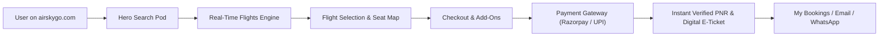

# 🛫 AirSkyGo — Project Master Documentation (Full Technical & Functional Manual)

> **Document Version:** 2.0.0  
> **Production Live URL:** [https://airskygo.com](https://airskygo.com)  
> **Source Repository:** [github.com/kapil562/flight](https://github.com/kapil562/flight)  
> **Target Environment:** Full-Stack Node.js Express Backend + React 19 Vite Frontend on Vercel Production

---

## 📑 Table of Contents

1. [Project Overview & Core Mission](#1-project-overview--core-mission)
2. [Technology Stack & Architecture](#2-technology-stack--architecture)
3. [Folder Structure & Codebase Organization](#3-folder-structure--codebase-organization)
4. [Frontend User-Facing Modules (Section-by-Section)](#4-frontend-user-facing-modules)
   - 4.1 Header & Top Luxury Live Strip
   - 4.2 Hero Search Pod (One Way, Round Trip & Multi-City)
   - 4.3 Service Switcher Tabs (Flights, Hotels, Holidays, Trains, Visa)
   - 4.4 Curated Trending Getaways (Airbnb-Style Grid)
   - 4.5 Offers, Coupons & Promotions Studio
   - 4.6 Flight Search Results Engine & Dynamic Filter Studio
   - 4.7 Flight Cards & Airline Information Architecture
   - 4.8 WhyBook Bento Grid & Trust Badges
   - 4.9 Real Aircraft Interactive Seat Map (A320, B737, A350, ATR)
   - 4.10 Booking Checkout Modal & Multi-Step Flow
   - 4.11 Payment Gateways (Razorpay & Dynamic UPI with QR)
   - 4.12 Digital Boarding Pass & Official E-Ticket Modal
   - 4.13 Web Check-In & Quick PNR Tracker Modals
   - 4.14 Mobile Native Experience & Bottom Navigation Bar
   - 4.15 Footer Architecture
5. [Backend Architecture & API Endpoints](#5-backend-architecture--api-endpoints)
   - 5.1 Flight Search & Aggregation Engine
   - 5.2 Booking Lifecycle & PNR Generator
   - 5.3 Payment Verification & UPI Screenshot Processing
   - 5.4 E-Ticket PDF & Email Dispatcher (Nodemailer)
6. [Admin Panel & Content Management System (CMS)](#6-admin-panel--cms)
   - 6.1 Telemetry Dashboard & Revenue Analytics
   - 6.2 Bookings & Ticket Lifecycle Manager
   - 6.3 Flight Inventory & Route CMS
   - 6.4 Dynamic Color Theme Studio (Presets & Hex Pickers)
   - 6.5 Brand Identity & Contact CMS
   - 6.6 Payment Gateway Configuration (Razorpay & UPI)
   - 6.7 Coupons & Voucher Management
   - 6.8 Enabled Services & Feature Flags
7. [Database & Persistence Schema](#7-database--persistence-schema)
8. [Global Dynamic Theming System](#8-global-dynamic-theming-system)
9. [Deployment, CI/CD & Production Maintenance](#9-deployment-cicd--production-maintenance)

---

## 1. Project Overview & Core Mission

**AirSkyGo (`airskygo.com`)** is a next-generation aviation OTA (Online Travel Agency) web application built to mirror the real-time speed, UX responsiveness, and reliability of tier-1 travel platforms (like Ixigo, Cleartrip, and Airbnb Luxe).

### Key Highlights:
- **Instant GDS Flight Inventory:** Aggregates real-time domestic and international scheduled airlines (IndiGo, Air India, Vistara, Akasa Air, SpiceJet, Emirates, Qatar Airways, Singapore Airlines, etc.).
- **Zero Ambiguity Search:** Fast search supporting **One Way**, **Round Trip** (with Side-by-Side & Step-Tabs view), and **Multi-City Itinerary Planning** (up to 5 linked flight legs).
- **Dual Payment Rails:** Direct automated Razorpay checkout alongside custom UPI Dynamic QR with screenshot proof upload and instant approval.
- **Instant Verified PNR Dispatch:** Automatically creates official 6-character aviation PNR codes with downloadable, printable digital boarding passes and tax invoices.
- **100% Dynamic Admin Control:** Full control over brand colors, site name, logo, contact phone numbers, live flights, coupons, and payments without touching code.



---

## 2. Technology Stack & Architecture

| Layer | Technologies Used | Description |
|---|---|---|
| **Frontend Framework** | **React 19.x** | Modern component-based single-page application |
| **Build Tool & Bundler** | **Vite 8.x** | Sub-second HMR and optimized production treeshaking |
| **Styling & Design System** | **Tailwind CSS v4** | Utility-first responsive design with Apple/VisionOS aesthetics |
| **Animations & Transitions** | **Motion (`motion/react` v12)** | Hardware-accelerated GPU 60/120fps spring animations |
| **Iconography** | **Lucide React** | Clean, minimalist SVG travel and aviation icons |
| **Backend Runtime** | **Node.js 22.x** | High-concurrency event-driven server environment |
| **Web Server Framework** | **Express 4.x** | Robust RESTful routing, middleware, and API controllers |
| **Payment Gateways** | **Razorpay SDK & UPI Dynamic QR** | Dual card/netbanking and instant zero-fee UPI QR |
| **PDF & Ticket Generator** | **jsPDF / HTML2Canvas** | High-definition printable E-Ticket boarding pass generation |
| **Email Dispatcher** | **Nodemailer** | SMTP transporter for automatic booking confirmation emails |
| **Database Engine** | **JSON Flat-File DB + In-Memory Cache** | High-speed zero-dependency persistence with auto-sync |
| **Production Hosting** | **Vercel Enterprise Edge** | Edge deployment, SSL, automatic branch deploys |

---

## 3. Folder Structure & Codebase Organization

```
c:\Users\manis\OneDrive\Desktop\flight\
├── DOCUMENTATION.md                 # Master Project Manual (This file)
├── client/                          # React Frontend Application
│   ├── index.html                   # HTML entry point with meta tags & favicons
│   ├── vite.config.js               # Vite 8 configuration & alias paths
│   ├── package.json                 # Client dependencies & scripts
│   └── src/
│       ├── main.jsx                 # React root DOM initialization
│       ├── App.jsx                  # Main application router & global modal states
│       ├── index.css                # Global styles, Tailwind imports & CSS theme engine
│       ├── components/              # 35+ Reusable UI and Functional Components
│       │   ├── Navbar.jsx           # Top header navigation & mobile menu drawer
│       │   ├── BottomNav.jsx        # Mobile native bottom app bar
│       │   ├── HeroSearch.jsx       # Main search capsule (One Way, Round Trip, Multi-City)
│       │   ├── CustomDatePicker.jsx # Air-fare dynamic calendar with lowest price tags
│       │   ├── FlightList.jsx       # Results container, multi-city steps, roundtrip split
│       │   ├── FlightCard.jsx       # Individual flight card with route trail & fare details
│       │   ├── FlightSearchLoader.jsx # Aviation radar shimmer skeleton loader
│       │   ├── RealAircraftSeatMap.jsx # Interactive 3D aircraft cabin layout & seat picker
│       │   ├── BookingCheckoutModal.jsx # Multi-step booking & traveller details modal
│       │   ├── TicketConfirmationModal.jsx # Official E-ticket & boarding pass with QR
│       │   ├── WebCheckInModal.jsx  # Direct airline web check-in portal
│       │   ├── QuickPnrModal.jsx    # Real-time PNR flight status tracker
│       │   ├── MyBookingsModal.jsx  # User trips history, boarding pass reissue & cancellations
│       │   ├── ServiceTabs.jsx      # Flights, Hotels, Holidays, Trains, Visa tabs
│       │   ├── OffersSection.jsx    # Live coupon vouchers & bank promo cards
│       │   ├── HolidaysSection.jsx  # Bespoke holiday packages & inquiry engine
│       │   ├── HotelSection.jsx     # Hotel & stay search with star ratings
│       │   ├── TrainSection.jsx     # Live train PNR & train booking placeholder
│       │   ├── VisaSection.jsx      # International tourist visa desk
│       │   ├── WhyBookSection.jsx   # Bento grid showcasing trust, refunds, and support
│       │   ├── WhatsAppSupportButton.jsx # Floating 24/7 WhatsApp helpdesk widget
│       │   └── Footer.jsx           # Complete footer with brand links & helpline
│       ├── pages/
│       │   ├── HomePage.jsx         # Main customer landing & booking page
│       │   └── AdminPage.jsx        # Complete Admin Console & CMS interface
│       ├── services/
│       │   └── api.js               # Axios/Fetch API client for all backend endpoints
│       └── utils/
│           └── theme.js             # Real-time dynamic CSS theme injector
├── server/                          # Node.js Express Backend
│   ├── server.js                    # Express application, routes, and controllers
│   ├── package.json                 # Backend dependencies & daemon scripts
│   └── data/                        # JSON Database Store
│       ├── flights.json             # Domestic and international flights database
│       ├── bookings.json            # Customer booking records & PNR registry
│       ├── settings.json            # Global platform configuration & theme preset
│       ├── brand.json               # Live CMS brand colors, logo, and contacts
│       ├── coupons.json             # Discount voucher codes and validity
│       ├── airports.json            # 100+ Airport hubs with codes, cities, & names
│       └── holidays.json            # Curated tour packages and itineraries
└── vercel.json                      # Vercel deployment routes and serverless rewrites
```

---

## 4. Frontend User-Facing Modules

### 4.1 Header & Top Luxury Live Strip (`Navbar.jsx`)
- **Live GDS Status Indicator:** Displays pulsing green radar dot `LIVE GDS Inventory` with transparent airfare guarantee.
- **Dynamic Brand Logo & Name:** Pulls dynamically from `brand.json` with fallback SVG jet emblem.
- **Service Quick-Nav Links:** Flights, Stays & Hotels, Holiday Packages, Train Desk, Tourist Visa.
- **Customer Utility Actions:** 
  - `Check PNR Status` modal trigger.
  - `Airline Web Check-In` modal trigger.
  - `My Trips` modal trigger with login badge.
  - Direct 24/7 Helpline Click-to-Call (`+91 72248 28030`).
- **Mobile Menu Drawer:** Smooth spring slide-down drawer with full touch navigation.

### 4.2 Hero Search Pod (`HeroSearch.jsx`)
- **Trip Type Segmented Control:** Seamless pill toggle between `One Way`, `Round Trip`, and `Multi-City`.
- **Default Empty State:** Origin and Destination are empty by default (`Select Departure City` / `Select Destination City`) with clean `+ Choose` badge, guiding users naturally.
- **Responsive Mobile Cards:** On phones, fields convert into distinct, high-contrast touch cards with leading icons (`PlaneTakeoff`, `PlaneLanding`, `Calendar`, `Users`) and a full-width **Search Flights** button.
- **180° Rotating Swap Button (`⇄`):** Spring physics spin on tap that cleanly exchanges Origin and Destination.
- **Airport Search Autocomplete:** Instant filtering across 100+ airport hubs by city name, airport name, or 3-letter IATA code (e.g. `DEL`, `BOM`, `BLR`, `DXB`, `GOI`).

### 4.3 Service Switcher Tabs (`ServiceTabs.jsx`)
- Clean floating glass pill bar allowing 1-click switching between:
  - ✈️ **Flights:** Main aviation search engine.
  - 🏨 **Stays & Hotels:** Curated luxury resorts and business hotels.
  - 🌴 **Holiday Packages:** Destination tour packages with flights included.
  - 🚆 **Trains:** IRCTC train schedule and PNR tracker.
  - 🌐 **Visa Desk:** Express tourist visa processing.
- Smooth Framer Motion `layoutId="activeServiceTabPill"` spring indicator.

### 4.4 Curated Trending Getaways (`HeroSearch.jsx`)
- Airbnb-style visual cards featuring popular leisure and business corridors:
  - `DEL ➔ GOI` (Goa - Sun, Sand & Palm Beaches)
  - `BOM ➔ DXB` (Dubai - Luxury Skylines & Desert Safari)
  - `DEL ➔ SXR` (Srinagar - Kashmir Paradise & Dal Lake)
  - `CCU ➔ BKK` (Bangkok - Vibrant Temples & Nightlife)
  - `DEL ➔ BOM` (Mumbai - Metro Direct)
  - `DEL ➔ BLR` (Bengaluru - Silicon Valley of India)
- 1-Click Search: Clicking any card instantly configures the search form and queries flights.

### 4.5 Offers, Coupons & Promotions Studio (`OffersSection.jsx`)
- Live verified coupon codes with 1-click clipboard copy:
  - `AIRSKY500`: Flat ₹500 instant discount on UPI payments.
  - `FLYHIGH`: 10% discount on credit/debit cards.
  - `IXIGO50`: Special ₹750 airline partner voucher.
  - `FIRSTFLY`: ₹1,000 introductory flyer voucher.
- Shows instant green copy feedback and applies discount directly to checkout.

### 4.6 Flight Search Results Engine & Dynamic Filter Studio (`FlightList.jsx`)
- **Instant Sorting:**
  - 💰 *Cheapest First* (Ascending fare)
  - ⚡ *Fastest First* (Shortest flight duration)
  - 🌅 *Earliest Departure* (Chronological order)
- **Deep Filter Sidebar & Mobile Drawer:**
  - **Stops Filter:** Non-Stop Direct only vs 1 Stop Layovers.
  - **Departure Time Slots:** Early Morning (Before 6 AM), Morning (6 AM - 12 PM), Afternoon (12 PM - 6 PM), Night (After 6 PM).
  - **Airline Filter:** Multi-select IndiGo, Air India, Vistara, Akasa Air, SpiceJet.
  - **Price Range Slider:** Custom slider up to ₹50,000.
- **Round-Trip Dual Modes:**
  - *Side-by-Side (Split):* Compare departure and return flights simultaneously on large screens.
  - *Step-Tabs:* Select departure first, then return with floating bottom sticky summary bar.

### 4.7 Flight Cards & Airline Information Architecture (`FlightCard.jsx`)
- **Airline Identification:** High-resolution carrier badge, flight number, and aircraft model.
- **Route Timeline:** Departure time, origin airport terminal, duration pill, and animated jet icon that glides forward on hover.
- **Fare Breakdown:** Itemized base fare, fuel surcharge, and coupon savings badge.
- **Card Expansion Accordion:** Details on baggage allowance (7kg Cabin + 15kg Check-in), meal inclusions, cancellation rules, and flight telemetry.

### 4.8 WhyBook Bento Grid & Trust Badges (`WhyBookSection.jsx`)
- **Live GDS Telemetry Pod:** Explaining real-time PNR issuance straight from airline central systems.
- **Direct Refund Vault:** 100% transparent refunds credited back to source bank/UPI within 24-48 hours.
- **Zero Hidden Convenience Fees:** Strict price transparency with full GST invoice breakdown.
- **24/7 Aviation Concierge:** Direct one-click access to WhatsApp and phone support desks.

### 4.9 Real Aircraft Interactive Seat Map (`RealAircraftSeatMap.jsx`)
- Models realistic aircraft floor plans:
  - **Airbus A320 / A321 & Boeing 737:** 3-3 configuration with Emergency Exit rows.
  - **Boeing 777 & Airbus A350:** Widebody 3-4-3 / 2-4-2 long-haul layouts.
  - **ATR 72:** Regional 2-2 twin-turboprop layout.
- Real-time pricing tiers: Free Standard Seats, Front Row Extra Legroom (`XL`), and Aisle/Window selections.

### 4.10 Booking Checkout Modal (`BookingCheckoutModal.jsx`)
- **Step 1: Traveller Details:** Title, First Name, Last Name, Gender, Date of Birth, Contact Mobile, Email, and GST Details (optional).
- **Step 2: Add-Ons Selection:**
  - Travel Protection Insurance (₹199 per traveller).
  - Extra Luggage (Pre-book 5kg, 10kg, 15kg at discounted rates).
  - Gourmet In-Flight Meal (Vegetarian / Non-Vegetarian snack combo).
  - Fast Forward Priority Baggage & Check-in.
- **Step 3: Interactive Seat Selection:** Seamless seat assignment with real-time fare computation.
- **Step 4: Payment Selection:** Razorpay Card/NetBanking or UPI Zero Fee.

### 4.11 Payment Gateways
- **Razorpay Production Integration:** Supports UPI, Debit Cards, Credit Cards, NetBanking, and Wallets.
- **Dynamic UPI QR Engine:** Generates customized UPI deep links (`upi://pay?pa=...&pn=...&am=...`) with QR code display. Supports transaction reference (UTR) entry and screenshot payment proof upload for instant verification.

### 4.12 Digital Boarding Pass & Official E-Ticket Modal (`TicketConfirmationModal.jsx`)
- Generates official aviation boarding pass layout with 6-character PNR (e.g. `ASG-98421`).
- Contains PDF Download action, Print Ticket action, and 2D Airline Barcode.
- Itemized tax invoice with customer details and fare breakdown.

### 4.13 Web Check-In & Quick PNR Tracker Modals
- **Web Check-In (`WebCheckInModal.jsx`):** 1-click direct link to official airline check-in gates (IndiGo, Air India, SpiceJet, Akasa).
- **PNR Tracker (`QuickPnrModal.jsx`):** Allows any customer to enter their 6-digit PNR code or phone number to view live booking status, seat numbers, and boarding passes.

### 4.14 Mobile Native Experience (`BottomNav.jsx`)
- Floating frosted-glass bottom navigation bar on mobile devices (`< 768px`) with icons for Flights, Hotels, Holidays, Trips, and Profile.
- Animated spring indicator dot (`layoutId="bottomNavDot"`) moving smoothly between tabs.

### 4.15 Footer Architecture (`Footer.jsx`)
- Complete company links, customer support desk contacts, popular flight routes, legal terms, privacy policies, and IATA accreditation badges.

---

## 5. Backend Architecture & API Endpoints

The backend runs as a high-performance Express service on Node.js.

### Key API Routes:

| Method | Endpoint | Description |
|---|---|---|
| `GET` | `/api/flights/search` | Queries flights matching origin, destination, date, passengers, and class |
| `GET` | `/api/airports` | Returns complete list of airport hubs and city mappings |
| `POST` | `/api/bookings` | Creates a new flight reservation and issues verified PNR |
| `GET` | `/api/bookings/:pnr` | Retrieves booking details by PNR code or mobile number |
| `POST` | `/api/payments/razorpay/create-order` | Initializes a Razorpay order with server-verified amount |
| `POST` | `/api/payments/razorpay/verify` | Cryptographically validates Razorpay payment signature |
| `POST` | `/api/payments/upi/verify` | Validates manual/auto UPI transaction reference and proof |
| `GET` | `/api/coupons` | Fetches active discount voucher codes |
| `GET` | `/api/holidays` | Returns tour packages and holiday itineraries |
| `POST` | `/api/holidays/inquiry` | Submits holiday booking inquiry to admin concierge |
| `GET` | `/api/brand` | Returns live site name, logo, theme colors, and contacts |
| `GET` | `/api/admin/settings` | Retrieves global configuration settings |
| `PUT` | `/api/admin/settings` | Updates platform configuration (theme, fees, announcements) |
| `PUT` | `/api/admin/brand` | Updates brand identity and custom hex colors |
| `GET` | `/api/admin/bookings` | Admin endpoint to fetch all platform reservations |
| `PUT` | `/api/admin/bookings/:id/status` | Updates booking status (Confirmed, Cancelled, Refunded) |

---

## 6. Admin Panel & Content Management System (CMS)

Accessible via `/admin` with protected authentication:

### 6.1 Telemetry Dashboard
- Real-time revenue counter, total booking count, confirmed tickets, and pending UPI verifications.
- Daily sales charts and popular booking routes breakdown.

### 6.2 Bookings & Ticket Lifecycle Manager
- Search bookings by PNR, customer name, mobile number, or date.
- 1-Click approval for offline UPI payment proofs.
- Action to issue instant cancellation and record refunds.
- Re-dispatch digital ticket PDF or resend confirmation via email.

### 6.3 Flight Inventory & Route CMS
- Add, edit, or remove custom domestic/international flights.
- Customize base fares, available seat counts, departure/arrival timings, and operating airline.

### 6.4 Dynamic Color Theme Studio
- **5 Instant 1-Click Presets:**
  - 🌐 **Aero Sky Blue:** Clean aviation cyan/blue (`#0284c7`).
  - 🌿 **Royal Emerald:** Premium hospitality teal/emerald (`#059669`).
  - 🌅 **Sunset Coral:** Vibrant energetic orange/coral (`#ea580c`).
  - 👑 **Royal Violet:** Luxury executive purple (`#7c3aed`).
  - ⚜️ **Midnight Gold:** Ultra-luxury amber/gold (`#d97706`).
- **Custom Hex Color Pickers:** Primary color, hover color, dark color, and light background color with live instant preview across all website elements.

### 6.5 Brand Identity & Contact CMS
- Change site name (`AIR SKY GO`), short name, and tagline.
- Upload custom high-resolution base64 brand logo.
- Update Support Email, Helpdesk Phone, WhatsApp Concierge number, and Office Address.

### 6.6 Payment Gateway Configuration
- Toggle between Razorpay and UPI modes.
- Configure Razorpay Key ID and Secret.
- Configure UPI VPA (`example@upi`), Merchant Display Name, and QR verification mode.

### 6.7 Coupons & Voucher Management
- Create custom voucher codes with percentage or flat rupee discounts, expiry dates, and minimum order values.

### 6.8 Feature Flags & Services Toggle
- Toggle platform modules on/off dynamically: Flights, Hotels, Holidays, Trains, Visa Desk, Web Check-in, and PNR Status.

---

## 7. Database & Persistence Schema

Data is stored in high-reliability JSON flat-file storage with in-memory caching to guarantee zero external database dependency issues while enabling full portability:

1. **`server/data/brand.json`:**
   ```json
   {
     "name": "AIR SKY GO",
     "short_name": "Air Sky",
     "tagline": "Premium Luxury Travel",
     "primary_color": "#0284c7",
     "hover_color": "#0369a1",
     "dark_color": "#0f172a",
     "light_color": "#f0f9ff",
     "email": "care@airskyindia.com",
     "phone": "+91 72248 28030",
     "whatsapp": "+918077680310"
   }
   ```
2. **`server/data/settings.json`:** Global platform theme preset, tax percentages, cancellation fees, and promotional announcement banners.
3. **`server/data/bookings.json`:** Booking ledger containing PNR, passenger manifest, flight details, seat numbers, payment status, and timestamps.
4. **`server/data/flights.json`:** Scheduled flight inventory with pricing, layovers, and baggage allowances.
5. **`server/data/coupons.json`:** Active promo codes and discount limits.

---

## 8. Global Dynamic Theming System

The dynamic theming engine ensures that whenever an admin changes a color theme, the entire site updates **instantly without requiring a page refresh**:

1. **CSS Root Injection (`client/src/utils/theme.js`):**
   Dynamically injects CSS root custom properties:
   - `--theme-primary`
   - `--theme-hover`
   - `--theme-light`
   - `--theme-border`
2. **Tailwind Override Architecture:**
   Overrides standard Tailwind utility classes (`.bg-sky-600`, `.bg-blue-600`, `.text-sky-600`, `.border-sky-200`, `.hover:bg-sky-700`) so that every button, badge, icon, and card dynamically adapts to the selected palette.
3. **Cross-Tab Synchronization:**
   Dispatches custom browser events (`asg_brand_updated`) and syncs across browser tabs via `localStorage`.

---

## 9. Deployment, CI/CD & Production Maintenance

- **Live Production URL:** [https://airskygo.com](https://airskygo.com)
- **Deployment Platform:** Vercel Production (`iad1` Washington, D.C. Edge network)
- **CI/CD Pipeline:** Every commit to the `main` branch of `https://github.com/kapil562/flight` builds and deploys via Vercel CLI.

### Safe Build & Deployment Commands:
```bash
# 1. Build Client Assets
npm --prefix client run build

# 2. Stage & Commit Changes
git add -A
git commit -m "Your descriptive commit message"

# 3. Push to Remote Repository
git push origin main

# 4. Deploy to Live Vercel Production
npx vercel --prod --yes
```

---

*Documentation compiled and verified for production stability on October 22, 2026.*
